# PULSO Curioso — Fábrica Autónoma de Contenido

> Genera **videos estilo documental** (YouTube + Facebook Reels) y **cómics** de forma autónoma, 24/7, con enfoque $0-first (caché/reciclado y cascada de proveedores gratuitos). Un `docker compose up -d` levanta el backend y el panel.

[](#-instalación-rápida)
[](#-arquitectura)
[](#-mission-control-panel-web)
[](#-licencia)

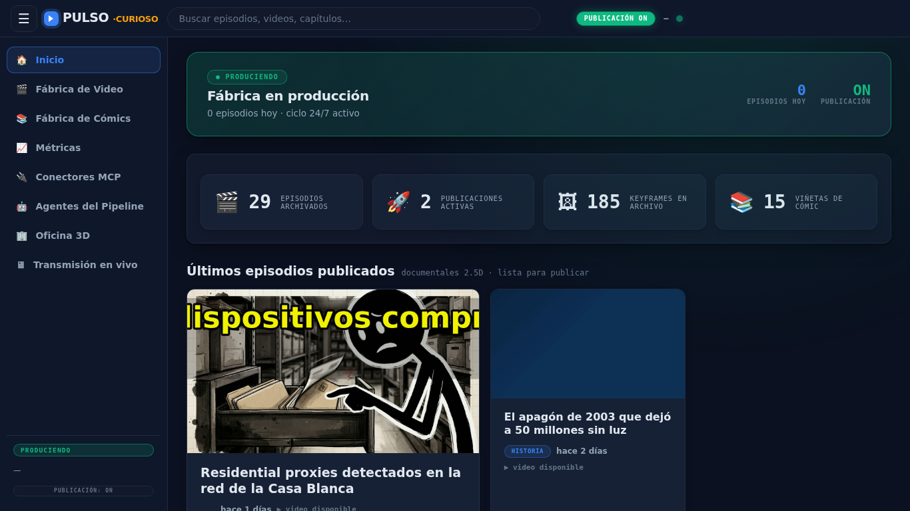

---

## Contenido

- [Qué hace](#-qué-hace)
- [Instalación rápida](#-instalación-rápida)
- [Tutorial de instalación (visual)](#-tutorial-de-instalación-visual)
- [Configuración (.env)](#-configuración-env)
- [Mission Control (panel web)](#-mission-control-panel-web)
- [Ejemplos generados](#-ejemplos-generados)
- [Arquitectura](#-arquitectura)
- [Verificación y operación](#-verificación-y-operación)
- [Solución de problemas](#-solución-de-problemas)
- [Documentación](#-documentación)

---

## Qué hace

| Módulo | Capacidades |
|---|---|
| **Fábrica de Video** | Descubre temas, escribe guion, genera keyframes (IA con cascada $0-first), narra con TTS, monta máster 9:16 con subtítulos dinámicos (ASS), deriva YouTube Short + Facebook Reel y publica vía Zernio (según configuración). |
| **Fábrica de Cómics** | Convierte guiones en capítulos con viñetas y portada scroll-stopper (carrusel v3), captions legibles en móvil, variantes A/B/C de portada y QC/publicación. |
| **Mission Control** | Panel web en vivo: cinta de producción, galería, métricas YT/FB, conectores MCP y Oficina 3D. |
| **Costos y aprendizaje** | Reciclado/caché/ingesta de imágenes para reducir generación; bucle `medir → aprender` post-episodio (honesto con datos reales, sin simulación). |

> Detalle técnico de mejoras recientes: [`MEJORAS-PRO-2026-11-10.md`](MEJORAS-PRO-2026-11-10.md).

---

## Instalación rápida

### Requisitos

- [Git](https://git-scm.com/)
- [Docker Engine](https://docs.docker.com/engine/install/) + [Docker Compose v2](https://docs.docker.com/compose/) (`docker compose`)
- ~8–15 GB de disco libre y 8 GB+ RAM recomendados

### 3 pasos

```bash
# 1) Descargar
git clone https://github.com/NickDev24/fabrica-stickman-V2.git
cd fabrica-stickman-V2

# 2) Configurar
cp .env.example .env
# edita .env con tus claves (Zernio/LLM opcionales)

# 3) Levantar
docker compose up -d --build
```

Abrir el panel: **[http://localhost:8611](http://localhost:8611)** · API/health: **[http://localhost:8610/api/health](http://localhost:8610/api/health)**

---

## Tutorial de instalación (visual)

Flujo simulado de extremo a extremo (descarga → configuración → build → verificación):

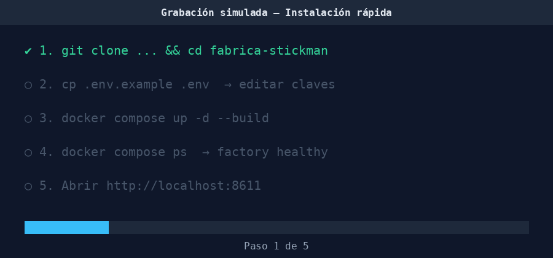

| 1. Clonar repositorio | 2. Crear `.env` | 3. Configurar variables |
|---|---|---|
| 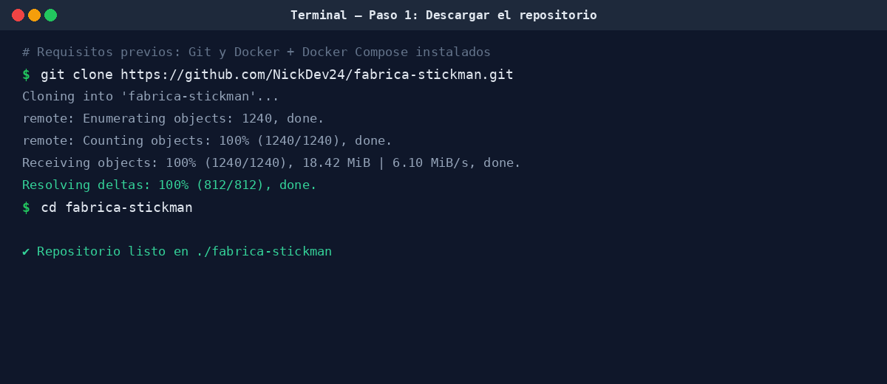 | 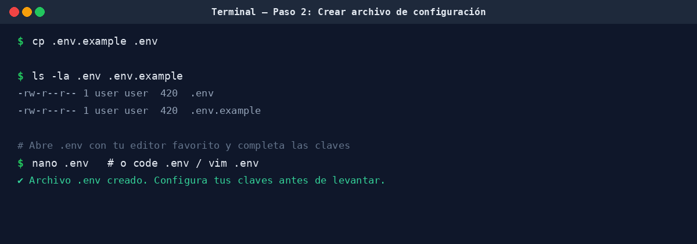 | 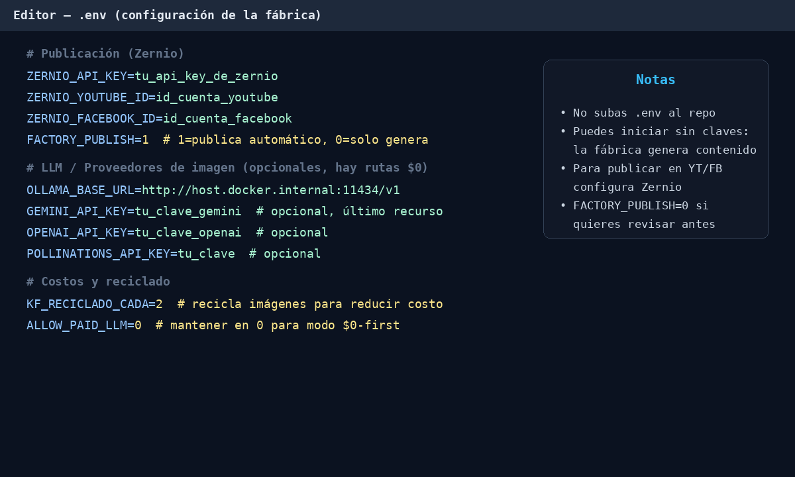 |

| 4. Levantar con Docker Compose | 5. Verificar servicios y panel |
|---|---|
| 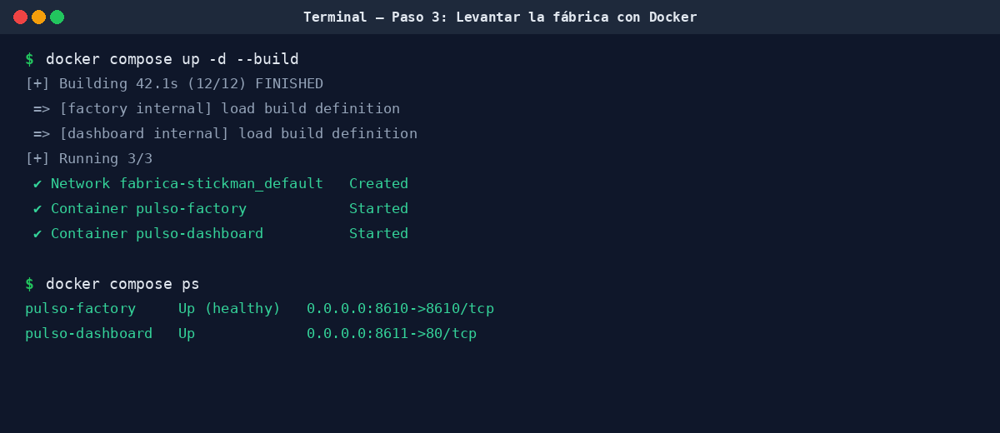 | 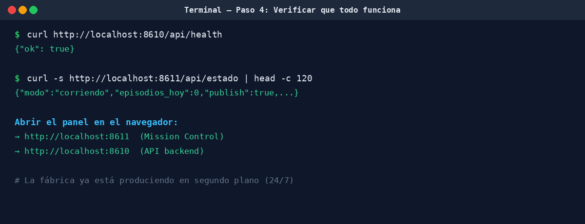 |

Guía detallada con explicación de cada sección/formulario y troubleshooting: **[`TUTORIAL_INSTALACION.md`](TUTORIAL_INSTALACION.md)**.

---

## Configuración (`.env`)

`cp .env.example .env` y ajusta según tu uso:

| Variable | Descripción |
|---|---|
| `ZERNIO_API_KEY`, `ZERNIO_YOUTUBE_ID`, `ZERNIO_FACEBOOK_ID` | Credenciales para publicación YouTube/Facebook vía Zernio |
| `FACTORY_PUBLISH` | `1` publica automáticamente (default en compose), `0` modo solo generación/revisión |
| `OLLAMA_BASE_URL` | Endpoint de Ollama (LLM local). En Docker: `http://host.docker.internal:11434/v1` |
| `GEMINI_API_KEY`, `OPENAI_API_KEY`, `POLLINATIONS_API_KEY` | Proveedores opcionales (la cascada prioriza rutas $0) |
| `KF_RECICLADO_CADA` | Frecuencia de reciclado de imágenes para reducir costo |
| `ALLOW_PAID_LLM` | `0` recomendado para operación $0-first |

> No subas `.env` al repositorio. Puedes operar sin claves para generación local; la publicación requiere credenciales válidas.

---

## Mission Control (panel web)

Servido por nginx en `http://localhost:8611` (proxy a `factoryd:8610`).

| Vista | Descripción |
|---|---|
| **Inicio** | Banner de estado, feed de episodios/capítulos recientes |
| **Fábrica de Video** | Cinta de producción (estaciones), galería, keyframes, métricas |
| **Fábrica de Cómics** | Prensa de tinta, galería de capítulos y viñetas |
| **Métricas** | Publicación/interacción YT/FB (vía Zernio) |
| **Conectores MCP** | Zernio, YouTube, Facebook, Telegram, LLM y más |
| **Oficina 3D** | Visualización 3D interactiva de agentes/estaciones |

| Inicio | Fábrica de Video |
|---|---|
|  | 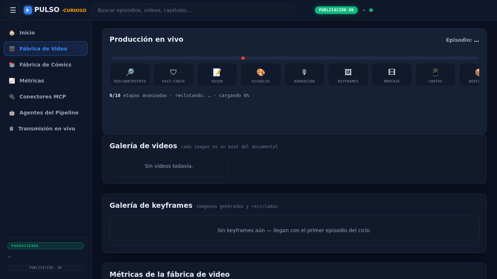 |
| **Fábrica de Cómics** | **Métricas** |
| 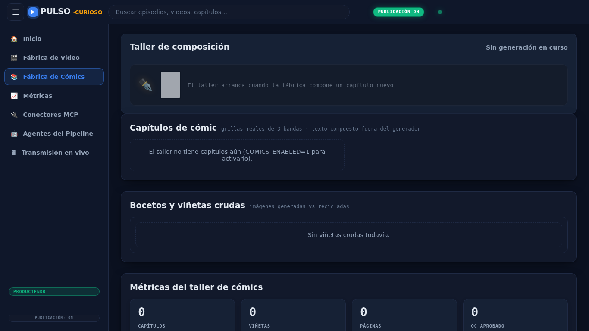 | 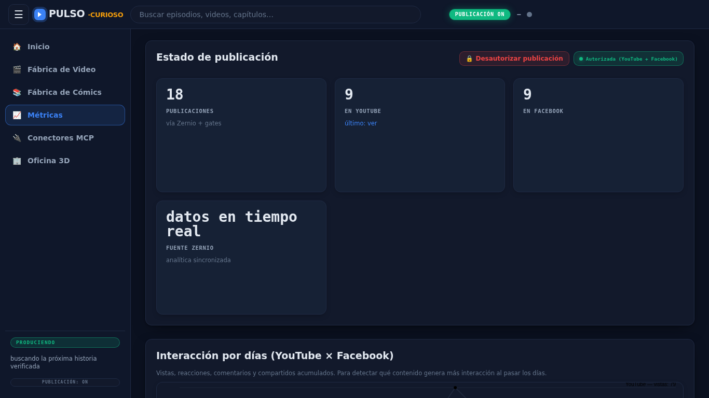 |
| **Conectores** | **Oficina 3D** |
| 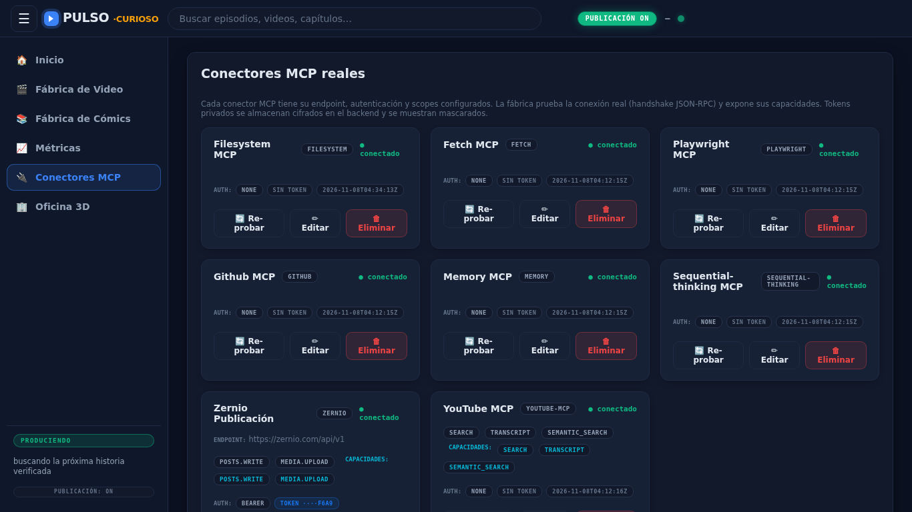 | 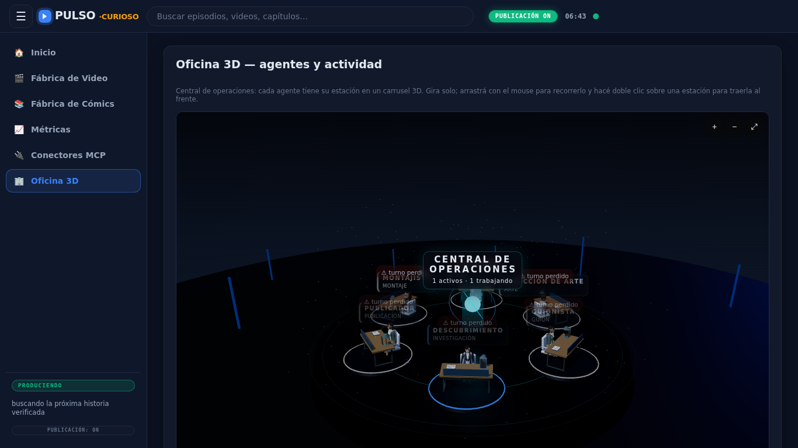 |

Recorrido grabado del panel: [`assets/docs/tutorial-dashboard.mp4`](assets/docs/tutorial-dashboard.mp4)

---

## Ejemplos generados

| Tipo | Archivo |
|---|---|
| Reel Facebook | [`assets/docs/examples/ejemplo-reel-facebook.mp4`](assets/docs/examples/ejemplo-reel-facebook.mp4) |
| YouTube Short | [`assets/docs/examples/ejemplo-youtube-short.mp4`](assets/docs/examples/ejemplo-youtube-short.mp4) |
| Collage (portada) | [`assets/docs/examples/ejemplo-collage.mp4`](assets/docs/examples/ejemplo-collage.mp4) |
| Cómic (capítulo vertical) | [`assets/docs/examples/ejemplo-comic.png`](assets/docs/examples/ejemplo-comic.png) |

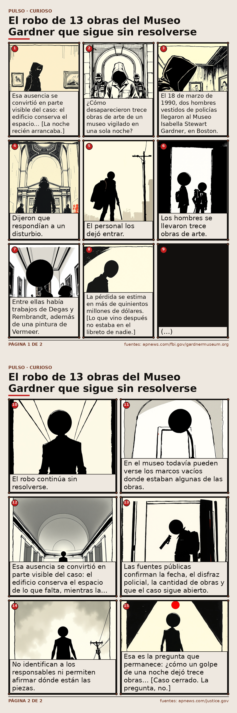

---

## Arquitectura

```text
fabrica-stickman/
├── docker/                 # Dockerfiles (factory + dashboard)
├── docker-compose.yml      # factory :8610 + dashboard :8611
├── pipeline/               # motor de producción (stages, config, gates)
├── factory/                # acting, render, motor, skills
├── state/                  # métricas, conectores, agentes, logs (runtime)
├── projects/               # salidas por proyecto (videos, cómics, artefactos)
├── assets/                 # assets estáticos + docs/tutorial + ejemplos
└── tests/                  # suite de regresión
```

- **Backend:** Python 3.13 + `factoryd` (REST `:8610`, WebSocket `/ws`).
- **Frontend:** nginx + HTML/CSS/JS vanilla (sin build step).
- **Render:** ffmpeg + TTS (Piper/edge-tts) + generación de imágenes con reciclado/cascada.

---

## Verificación y operación

```bash
# Salud y estado
docker compose ps
curl http://localhost:8610/api/health
curl -s http://localhost:8611/api/estado | head

# Logs / reinicio / parada
docker compose logs -f factory
docker restart pulso-factory
docker compose down
```

> Tras cambios en procesos de larga vida (p.ej. `factoryd.py`), reinicia el contenedor: `docker restart pulso-factory`.

Tests (si tienes entorno local de desarrollo):

```bash
.venv/bin/python -m pytest -q
```

---

## Solución de problemas

| Síntoma | Causa probable | Acción |
|---|---|---|
| Factory no healthy / no levanta | Error de build, volúmenes o puertos | `docker compose logs factory`, revisar `docker compose ps` y puertos `8610/8611` |
| LLM local no conecta | Ollama en host no alcanzable | Verificar Ollama activo y `OLLAMA_BASE_URL=http://host.docker.internal:11434/v1` |
| 429/rate-limit en imágenes | Cuota de proveedor gratuito | Esperado: fallback + reciclaje/caché; mantener `KF_RECICLADO_CADA` e ingesta |
| No publica en redes | Faltan credenciales o publish off | Revisar `ZERNIO_*`, `FACTORY_PUBLISH` y `/api/estado` |

Más detalle: [`TUTORIAL_INSTALACION.md`](TUTORIAL_INSTALACION.md).

---

## Documentación

- **Tutorial de instalación completo:** [`TUTORIAL_INSTALACION.md`](TUTORIAL_INSTALACION.md)
- **Mejoras PRO recientes:** [`MEJORAS-PRO-2026-11-10.md`](MEJORAS-PRO-2026-11-10.md)

---

## Licencia

MIT. Ver el repositorio para detalles de uso y contribución.
