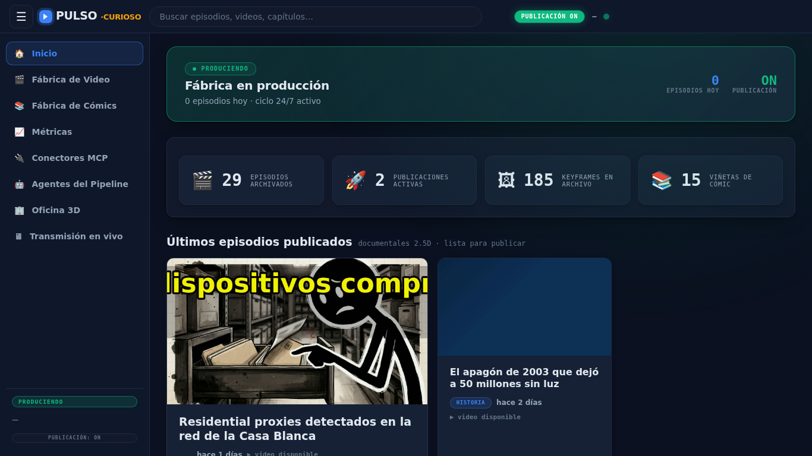
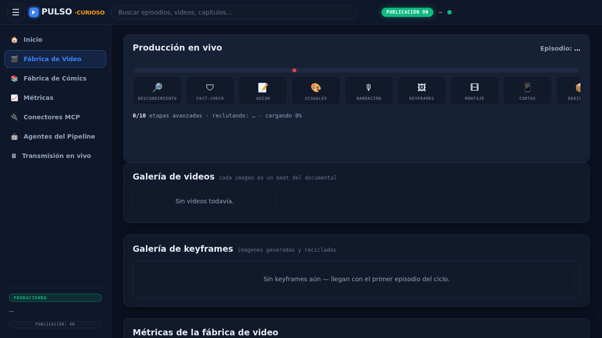
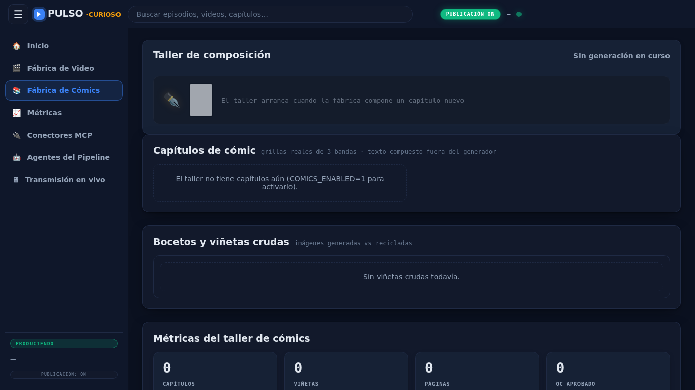
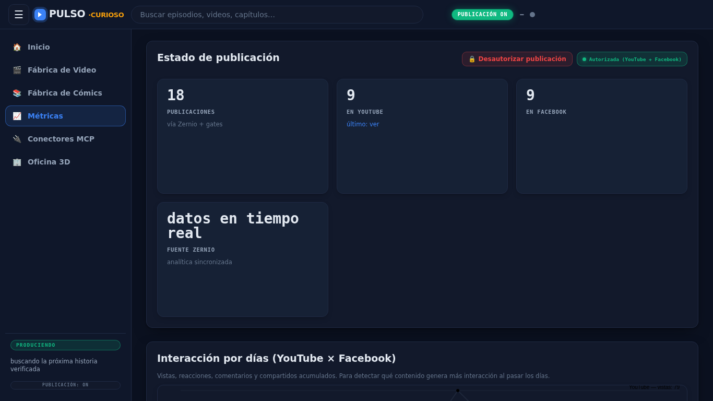
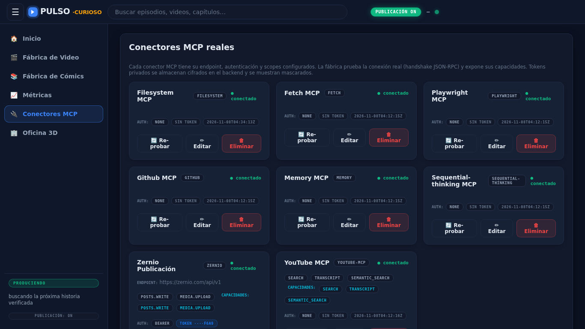
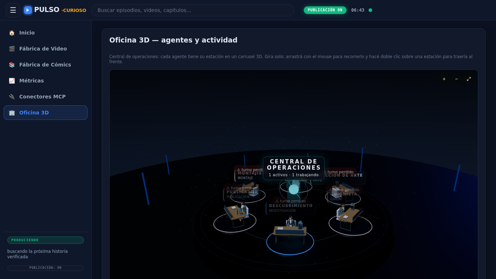
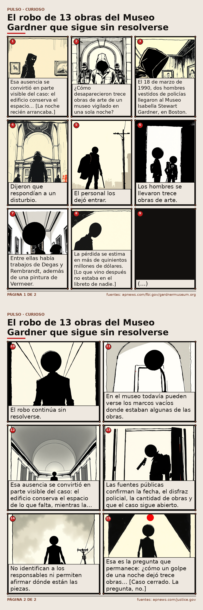

# Tutorial: instalación, configuración y deploy — Stickman Factory V2

Guía operativa para desplegar la fábrica en local con Docker Compose, configurar `.env` (secretos, cuentas/canales) y verificar el sistema.

**Repo:** https://github.com/NickDev24/fabrica-stickman-V2

## Videos tutoriales

### Instalación y puesta en marcha
<video src="assets/docs/tutorial-install.mp4" controls width="960"></video>

[`assets/docs/tutorial-install.mp4`](assets/docs/tutorial-install.mp4)

### Configuración, dashboard y operación
<video src="assets/docs/tutorial-dashboard.mp4" controls width="960"></video>

[`assets/docs/tutorial-dashboard.mp4`](assets/docs/tutorial-dashboard.mp4)

## 1. Requisitos
- Git, Docker Engine 24+, Docker Compose v2
- 8–15 GB disco, 8 GB+ RAM recomendado, puertos `8610`/`8611` libres
- (Opcional) Ollama en host, claves LLM/imágenes, credenciales Zernio

```bash
git --version && docker --version && docker compose version
```

**Importante (compose):** `docker-compose.yml` monta `.:/app`, `/home/facu/piper-env`, `/home/facu/.local/bin` con `user: 1000:1000`, `HOME=/home/facu` y `OLLAMA_BASE_URL=http://host.docker.internal:11434/v1`. Ajusta rutas/usuario/HOME a tu entorno si es necesario.

## 2. Instalación
```bash
git clone https://github.com/NickDev24/fabrica-stickman-V2.git
cd fabrica-stickman-V2
cp .env.example .env
# editar .env
```

## 3. Configuración (.env)
Variables (ver `.env.example`):
- **LLM/proveedores:** `MISTRAL_API_KEY`, `QWEN_API_KEY`, `GEMINI_API_KEY`, `GOOGLE_GEMINI_API_KEY`, `CLOUDFLARED_ACCOUNTS_ID`, `CLOUDFLARED_WORKER_AI`, `BADROCK_API_KEY`, `AIONLABS_API_KEY`, `HUGGINFACE_TOKEN`, `KAGGLE_API_KEY`, `POLLINATIONS_API_KEY`, `NAME_PROJECT`, `NUMBER_PROJECT`, `ID_PROJECT`
- **Publicación y canales:** `ZERNIO_API_KEY`, `ZERNIO_ACCOUNT_ID`, `ZERNIO_FACEBOOK_ID`, `ZERNIO_YOUTUBE_ID`, `AUTO_PUBLISH`, `FACTORY_PUBLISH`
- **Producción/costos:** `KF_RECICLADO_CADA`, `COMICS_ENABLED`, `COMICS_CAPTIONS_LLM`, `ALLOW_PAID_LLM`, `GEMINI_PRESUPUESTO_USD_MES`, `ALLOW_REMOTE_LLM`, `CF_MAX_IMAGENES_DIA`
- **Integraciones:** `TELEGRAM_TOKEN_BOT`, `TELEGRAM_CHAT_ID`

No subir `.env`. Para modo solo revisión: `FACTORY_PUBLISH=0`.

## 4. Deploy
```bash
docker compose up -d --build
docker compose ps
```
Servicios: `factory` (`8610`, health `/api/health`) y `dashboard` (`8611`).

## 5. Verificación
```bash
curl http://localhost:8610/api/health   # {"ok": true}
```
Dashboard: http://localhost:8611

## 6. Panel (capturas)
| Inicio | Video | Cómics |
|---|---|---|
|  |  |  |

| Métricas | Conectores | Oficina 3D |
|---|---|---|
|  |  |  |

## 7. Ejemplos de producción
### Reel corto (YouTube Short)
<video src="assets/docs/examples/reel-corto-youtube-short.mp4" controls width="420"></video>

### Reel Facebook
<video src="assets/docs/examples/reel-facebook.mp4" controls width="420"></video>

### Trailer (Facebook Reel)
<video src="assets/docs/examples/trailer-facebook-reel.mp4" controls width="420"></video>

### Cómic


## 8. Operación y troubleshooting
```bash
docker compose logs -f factory
docker restart pulso-factory
docker compose down
```
Revisar volúmenes/rutas, puertos, `OLLAMA_BASE_URL`, credenciales `ZERNIO_*` y cuotas de proveedores ante fallos.
